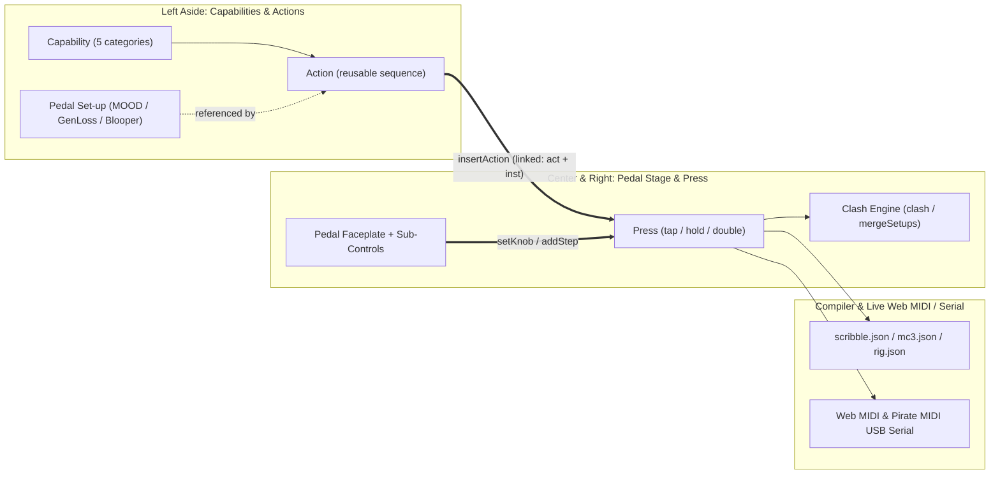

# Stomp Stacks v3 — UI, Domain & Pedal Capabilities Implementation Plan

> [!IMPORTANT]
> **Sources of Truth & Documentation Artifacts**
> - **Prototype Reference**: [Stomp Stacks v3.dc.html](file:///c:/reyn/Projects/stomp-stacks-designs/Stomp%20Stacks%20v3.dc.html) & [stomp-stacks-session-changes.md](file:///c:/reyn/Projects/stomp-stacks-designs/stomp-stacks-session-changes.md)
> - **Domain Glossary**: [CONTEXT.md](../CONTEXT.md)
> - **Architecture Decisions**: [0001-linked-actions-and-pedal-setups.md](./adr/0001-linked-actions-and-pedal-setups.md) & [0002-order-dependent-clash-and-setup-merging.md](./adr/0002-order-dependent-clash-and-setup-merging.md)

---

## 1. Domain Model & State Architecture (`src/state/` & `src/data/`)

### 1.1 Updated Types (`src/state/types.ts`)
- **`Message` (replaces `MacroStep`)**:
  - `device: string` (`'blooper' | 'mood' | 'elcap' | 'genloss'`)
  - `control: string` (control ID or `'pc'`)
  - `value: number | null` (`0–127`, discrete toggle option, PC slot number, or `null` for momentary footswitch)
  - `set?: string` (Set-up ID when `control === 'pc'` or linked to a hardware Set-up)
  - `act?: string` (Action ID when part of a linked Action group)
  - `inst?: number` (Unique group instance ID per insertion into a Press)
  - `from?: string` (Provenance label `"was “<Action>”, changed"` after detaching/modifying)
  - `label?: string`
- **`CapabilityDef` (`src/data/capabilities.ts`)**:
  - `id: 'conductor' | 'buffer' | 'glue' | 'loop' | 'wear'`
  - `name: string`, `colour: string`, `blurb: string`
- **`ActionDef` (`src/data/actions.ts`)**:
  - `id: string`, `name: string`, `caps: CapabilityId[]`, `what: string`, `steps: Message[]`
- **`PedalSetup` (`src/data/setups.ts`)**:
  - `id: string`, `device: 'mood' | 'genloss' | 'blooper'`, `name: string`, `slot: number`, `saved: boolean`
  - `move: Record<string, boolean>` (which knobs are assigned to ramp/wiggle)
  - `fall: Record<string, boolean>` (per-knob or global polarity: rise vs fall)
  - `bounce: boolean`, `sweep: 'top' | 'bottom'`, `shape?: 'tri' | 'square'`, `random?: boolean`, `sync?: boolean`
  - `custom?: Record<string, boolean>` (non-motion dip switches: e.g., Gen Loss `classic`, `spread`, `miso`, `dryType`, `dropByp`, `snagByp`; Blooper `dryKill`, `cvClock`, `playDub`, `bankA`, `bankB`; MOOD `trails`, `motbMicro`, `motbWet`)
- **`StompState` additions**:
  - `ctrlMin: boolean` (collapsed summary state for Controller + Brain panel; default `false`)
  - `drag: { key: string; v: number; dev?: string; ctl?: string } | null` (local draft state during slider drag; commits on pointer-up/key-up/blur)
  - `conflict: { act: string; device: string; oldSet: string; newSet: string; oldName: string } | null` (active preset-load conflict modal state)
  - `peek: { keys: string[]; id: string; pin?: boolean } | null` (hover peek & click-to-pin inline editor state)
  - `mode: 'assign' | 'build'`, `actEdit: string | null`, `focus: string | null`
  - `libOpen: boolean`, `capOpen: Record<string, boolean>`, `lens: string | null`
  - `actions: ActionDef[]`, `pedalSets: PedalSetup[]`, `setsOpen: string | null`, `walkIndex: number`, `instSeq: number`
  - `setupStep: number | null` (3-step Rig Setup Wizard, initialized from `localStorage.getItem('stomp-stacks:setup-done') ? null : 1`)
  - `hintOpen: string | null`, `hintAll: boolean`, `notice: string | null`

---

## 2. Official Pedal MIDI Specifications & Control Maps (`src/data/devices.ts`)

> [!WARNING]
> All fallback `base + index` calculations from the prototype and mismatched CCs in `src/data/devices.ts` will be replaced with the exact manufacturer MIDI mappings below. Duplicate `*_discrete` faceplate hotspots are consolidated into the physical footswitch popovers, while MIDI-only continuous/utility controls are exposed with `sub: true`.

### 2.1 Chase Bliss Blooper (`blooper`)
- **Default Channel**: `2` (or user-assigned in Rig; `pcOffset: 0`, where `PC 0–15` recalls **Saved Audio Loops 1–16**).
- **Faceplate Knobs (`0–127`)**:
  - `volume`: **Ramp / Volume** — `CC 14`
  - `layers`: **Layers** — `CC 15`
  - `repeats`: **Repeats** — `CC 16`
  - `modA`: **Modifier A** — `CC 17`
  - `stability`: **Stability** — `CC 18`
  - `modB`: **Modifier B** — `CC 19`
- **Faceplate Toggles**:
  - `chA`: **Mod A Bank (`1 2 3`)** — `CC 21` · values: `1` (`1`), `2` (`2`), `3` (`3`)
  - `mode`: **Mode (`norm add samp`)** — `CC 22` · values: `normal` (`1`), `additive` (`2`), `sampling` (`3`)
  - `chB`: **Mod B Bank (`4 5 6`)** — `CC 23` · values: `4` (`1`), `5` (`2`), `6` (`3`)
  - `undo`: **Undo / Redo / Preview Toggle** — `CC 24` (Save/Preview toggle: `1`/`2`/`3`) + transport Undo (`CC 5 = 127`) / Redo (`CC 6 = 127`)
- **Faceplate Footswitches (Consolidated Popover Options)**:
  - `record` (**Left Switch**):
    - `record` (`CC 1 = 127`), `play` (`CC 2 = 127`), `overdub` (`CC 3 = 127`), `one-shot dub` (`CC 9 = 127`), `mod A on` (`CC 30 = 127`), `mod A off` (`CC 30 = 0`)
  - `loop` (**Right Switch**):
    - `stop` (`CC 4 = 127`), `hold switch B` (`CC 8 = 127`), `erase` (`CC 7 = 127`), `mod B on` (`CC 31 = 127`), `mod B off` (`CC 31 = 0`)
- **Secondary / MIDI-Only Sub-Controls (`sub: true`)**:
  - `rampSpeed`: **Ramp Speed** — `CC 20` (`0–127` knob)
  - `rampOn`: **Ramping On/Off** — `CC 52` (`off = 0`, `on = 127`)
  - `clockIgnore`: **MIDI Clock** — `CC 51` (`follow clock = 0`, `ignore clock = 127`)
  - `loopSlot`: **Load Saved Loop (1–16)** — `PC 0–15`

### 2.2 Chase Bliss MOOD MkI (`mood`)
- **Default Channel**: `2` (`PC 0` = Live Mode, `PC 1` = Right Toggle Slot 1, `PC 2` = Left Toggle Slot 2, `PC 3–122` = MIDI Preset Slots).
- **Faceplate Knobs (`0–127`)**:
  - `time`: **Time** — `CC 14`
  - `mix`: **Mix (Ramp)** — `CC 15`
  - `length`: **Length** — `CC 16`
  - `modWet`: **Modify — Wet** — `CC 17`
  - `clock`: **Clock** — `CC 18`
  - `modMicro`: **Modify — Micro** — `CC 19`
- **Faceplate Toggles**:
  - `wetmode`: **Wet Effect (`reverb delay slip`)** — `CC 21` · values: `reverb` (`1`), `delay` (`2`), `slip` (`3`)
  - `routing`: **Routing (`in · ○+in · ○`)** — `CC 22` · values: `in` (`1`), `loop + in` (`2`), `loop` (`3`)
  - `micromode`: **Micro-Looper Mode (`env tape stretch`)** — `CC 23` · values: `env` (`1`), `tape` (`2`), `stretch` (`3`) *(fixed to match official MkI order)*
  - `preset`: **Preset Toggle** — recalls `slot 2 · left` (`PC 2`), `live · middle` (`PC 0`), `slot 1 · right` (`PC 1`)
- **Faceplate Footswitches (Consolidated Popover Options)**:
  - `wet` (**Left Switch — Wet Channel**, `CC 103`):
    - `wet on` (`127`), `wet off` (`0`), `wet only (mute micro)` (`85`), `both channels off` (`0`)
  - `microloop` (**Right Switch — Micro-Looper**, `CC 102`):
    - `micro on / freeze` (`127`), `micro off` (`0`)

### 2.3 Strymon El Capistan V2 (`elcap`)
- **Default Channel**: `1` (`PC 0–126` = Presets, `PC 127` = Manual / Live Knobs Mode).
- **Faceplate Knobs (`0–127`)**:
  - `time`: **Time** — `CC 12`
  - `wow`: **Wow & Flutter** — `CC 13`
  - `age`: **Tape Age** — `CC 14`
  - `cmix`: **Mix** — `CC 16`
  - `repeats`: **Repeats** — `CC 17`
  - `spring`: **Spring Reverb** — `CC 18`
- **Faceplate Toggles**:
  - `head`: **Tape Head** — `CC 11` · values: `fixed` (`1`), `multi` (`2`), `single` (`3`)
  - `cmode`: **Mode** — `CC 15` · values: `a` (`1`), `b` (`2`), `c` (`3`)
- **Faceplate Footswitches (Consolidated Popover Options)**:
  - `tap` (**Tap / SOS Switch**):
    - `tap / sos splice` (`CC 93 = 127`), `infinite hold on` (`CC 27 = 127`), `infinite hold off` (`CC 27 = 0`)
  - `onoff` (**On / Bypass Switch**, `CC 102`):
    - `engage` (`127`), `bypass` (`0`)
- **Secondary / MIDI-Only Sub-Controls (`sub: true`)**:
  - `contour`: **Low End Contour** — `CC 19` (`0–127` knob)
  - `bias`: **Tape Bias** — `CC 20` (`0–127` knob)
  - `tapDiv`: **Tap Division** — `CC 21` (toggle options)
  - `crinkle`: **Tape Crinkle** — `CC 22` (`0–127` knob)
  - `boost`: **Boost / Cut** — `CC 23` (`0–127` knob, `64 = unity`)
  - `clockDiv`: **Clock Division** — `CC 25` (toggle options)

### 2.4 Chase Bliss Generation Loss MKII (`genloss`)
- **Default Channel**: `4` in multi-pedal Rig (`PC 0` = Live Mode, `PC 1` = Right Toggle Slot 1, `PC 2` = Left Toggle Slot 2, `PC 3–122` = MIDI Preset Slots).
- **Faceplate Knobs (`0–127`)**:
  - `wow`: **Wow** — `CC 14`
  - `volume`: **Volume (Ramp)** — `CC 15`
  - `model`: **Model / LP** — `CC 16`
  - `flutter`: **Flutter** — `CC 17`
  - `saturate`: **Saturate / Gen** — `CC 18`
  - `failure`: **Failure / HP** — `CC 19`
- **Faceplate Toggles**:
  - `aux`: **Aux Mode (`stop filter fail`)** — `CC 21` · values: `stop` (`1`), `filter` (`2`), `fail` (`3`)
  - `dry`: **Dry Mode (`none small unity`)** — `CC 22` · values: `none` (`1`), `small` (`2`), `unity` (`3`)
  - `noise`: **Noise Mode (`none mild heavy`)** — `CC 23` · values: `none` (`1`), `mild` (`2`), `heavy` (`3`)
  - `preset`: **Preset Toggle** — recalls `slot 2 · left` (`PC 2`), `live · middle` (`PC 0`), `slot 1 · right` (`PC 1`)
- **Faceplate Footswitches (Consolidated Popover Options)**:
  - `auxSw` (**Left Switch — Aux**, `CC 103`):
    - `aux engage` (`127`), `aux off (wind up / release)` (`0`)
  - `bypass` (**Right Switch — Bypass**, `CC 102`):
    - `engage` (`127`), `bypass` (`0`)
- **Secondary / MIDI-Only Sub-Controls (`sub: true`)**:
  - `rampSpeed`: **Ramp Speed** — `CC 20` (`0–127` knob)
  - `auxOnset`: **Aux Onset (Wind-Down Speed)** — `CC 24` (`fast = 1`, `medium = 2`, `slow = 3`)
  - `hiss`: **Hiss Level** — `CC 27` (`0–127` knob)
  - `hum`: **Mechanical Hum** — `CC 28` (`0–127` knob)
  - `pop`: **Crinkle & Pop** — `CC 29` (`0–127` knob)
  - `rampOn`: **Ramp / Bounce On/Off** — `CC 52` (`off = 0`, `on = 127`)

---

## 3. Multi-Pedal Chase Bliss Dip-Switch Set-ups (`src/data/setups.ts`)

The `MOOD set-ups` modal in `v3.dc.html` will be generalized into **Pedal Set-ups**, supporting all three Chase Bliss pedals in the Rig with their authentic 16-switch (Left 8 + Right 8) rear diagrams and hardware save flows:

| Pedal | Left Bank (8 → 1, seen from behind) | Right Bank (8 → 1, seen from behind) | Speed Knob | Hardware Recall & Save Flow |
| :--- | :--- | :--- | :--- | :--- |
| **MOOD MkI** (`mood`) | `Sweep (B/T)`, `Trails`, `Shape (▲/■)`, `Modify ○`, `Clock`, `Modify ●`, `Length`, `Time` *(Up = Fall, Down = Rise)* | `MoTB ○`, `MoTB ●`, `Bounce`, `Modify ○`, `Clock`, `Modify ●`, `Length`, `Time` *(Up = Off, Down = On)* | `Mix (Ramp)` (`CC 15`) | Saved into `PC 1–122` (`Slot 1–2` via toggle + hold both footswitches; `Slot 3+` via MIDI PC + hold both footswitches). |
| **Generation Loss MKII** (`genloss`) | `Sweep (B/T)`, `Polarity (Rise/Fall)`, `Bounce`, `Random`, `Flutter`, `Saturate`, `Failure`, `Model`, `Wow` | `MISO`, `Spread`, `Dry Type`, `Drop Byp`, `Snag Byp`, `Hum Byp`, `Classic`, `Bypass` | `Volume (Ramp)` (`CC 15` / `CC 20`) | Identical 4-step Chase Bliss preset save into `PC 1–122` (`Slot 1–2` via toggle or `Slot 3+` via MIDI PC while holding both footswitches). |
| **Blooper** (`blooper`) | `Sweep (B/T)`, `Polarity (Rise/Fall)`, `Dry Kill`, `CV Clock`, `Play/Dub`, `Bank A`, `Bank B`, `Layers (Rise/Fall)` | `Bounce`, `Random`, `Sync`, `Mod B`, `Stability`, `Mod A`, `Repeats`, `Layers` | `Volume (Ramp)` (`CC 14` / `CC 20`) | Physical dip-switch setup walkthrough + MIDI `CC 52 = 127` (Ramp On) & `CC 20` (Ramp Speed). Leaves `PC 0–15` dedicated to audio loops 1–16. |

### Seed Set-ups (`SEED_SETS`)
1. **`clockwig` (`mood`, Slot 1)**: `Clock` moving, `Bounce = on`, `Sweep = top`, `Shape = tri`.
2. **`smearswell` (`mood`, Slot 2)**: `Modify ● (Wet)` moving, `Bounce = off` (glide), `Sweep = top`, `Shape = tri`.
3. **`classicwiggle` (`genloss`, Slot 1)**: `Classic = on`, `Model/LP` moving, `Bounce = on`, `Sweep = top`.
4. **`stereochorus` (`genloss`, Slot 2)**: `Dry Type = on`, `Spread = on`, `MISO = on` (malfunctioning stereo tape chorus).
5. **`bloopmodwig` (`blooper`, physical + `CC 52`)**: `Mod A` moving, `Sync = on`, `Bounce = on`, `Sweep = top`.
6. **`bloopwearwig` (`blooper`, physical + `CC 52`)**: `Stability` moving, `Bounce = on`, `Sweep = top`.

---

## 4. Capabilities & Seed Actions Catalog (`src/data/capabilities.ts` & `src/data/actions.ts`)

### 4.1 The 5 Capabilities
1. **`conductor`** (`#f7c948`) — *"keeps everything in step and changes several things with one stomp — the scene changes."*
2. **`micro-buffer`** (`#9fe0c0`) — *"catches tiny moments of what you play, then freezes, slices and retunes them."*
3. **`spatial glue`** (`#b9a6e6`) — *"the space around everything — washes, multi-head echoes, spring tanks, and keeping layers behind the dry guitar."*
4. **`macro-loop`** (`#e08fc0`) — *"long phrases: record, overdub, fading repeats, sound-on-sound splice, and layer history."*
5. **`tape & wear`** (`#ef7d5c`) — *"wow, flutter, saturation, VHS/camcorder decay, crinkles, and reel-to-reel tape stops."*

### 4.2 Complete Seed Actions Catalog (46 Actions Across All 4 Pedals)

#### A. Multi-Pedal `conductor` Actions (5)
1. **`neutral start`** (`conductor`) — `blooper: stability=0`, `mood: mix=64, wetmode=1`, `elcap: pc=127, repeats=32`, `genloss: auxSw=0, failure=0` · *"puts every pedal in the rig back to a clean, predictable starting place."*
2. **`scene drop`** (`conductor`, `macro-loop`, `micro-buffer`) — `blooper: modA=32, record(modA on)=127`, `mood: microloop=127`, `genloss: wow=64` · *"drops the loop to half-speed and freezes a micro-texture on the same stomp."*
3. **`capture & wash`** (`conductor`, `macro-loop`, `spatial glue`) — `blooper: one-shot dub (cc9=127)`, `mood: wetmode=1, wet=127`, `elcap: onoff=127` · *"catches one full loop pass while opening the reverb and tape echo."*
4. **`tape stop everything`** (`conductor`, `tape & wear`) — `genloss: aux=1, auxSw=127`, `elcap: time=0`, `blooper: loop(stop)=127` · *"winds the whole board down to a halt at the end of a song."*
5. **`all bypass (dry guitar)`** (`conductor`) — `mood: microloop=0, wet=0`, `elcap: onoff=0`, `genloss: bypass=0` · *"clears every wet effect at once so only your dry guitar comes through."*

#### B. Chase Bliss Blooper Actions (15)
6. **`record / play`** (`macro-loop`) — `blooper: record (cc1=127)` · *"first stomp records, the next one plays."*
7. **`punch overdub`** (`macro-loop`) — `blooper: overdub (cc3=127)` · *"jumps straight into or out of overdubbing without cycling states."*
8. **`one-shot dub`** (`macro-loop`) — `blooper: one-shot dub (cc9=127)` · *"records for one exact loop pass, then drops back to play on its own."*
9. **`fading repeats (frippatronics)`** (`macro-loop`, `spatial glue`) — `blooper: mode=1, repeats=40` · *"older layers slowly fade away as you play fresh ones over the top."*
10. **`infinite lock`** (`macro-loop`) — `blooper: repeats=127` · *"locks the loop so layers never decay."*
11. **`undo a layer`** (`macro-loop`) — `blooper: undo (cc5=127)` · *"peels the last overdub off."*
12. **`redo a layer`** (`macro-loop`) — `blooper: redo (cc6=127)` · *"brings the last undone overdub back."*
13. **`peel back layers`** (`macro-loop`) — `blooper: layers=32` · *"steps backward through your recorded layer stack."*
14. **`stop loop`** (`macro-loop`) — `blooper: stop (cc4=127)` · *"stops playback immediately without erasing."*
15. **`sampler one-shot`** (`macro-loop`, `micro-buffer`) — `blooper: mode=3, play (cc2=127)` · *"retriggers the loop from the top like a sample pad on every stomp."*
16. **`engage mod A (half-speed)`** (`micro-buffer`, `macro-loop`) — `blooper: chA=1, modA=32, modA_on (cc30=127)` · *"turns on Modifier A tuned down an octave."*
17. **`stutter / scramble burst`** (`micro-buffer`) — `blooper: chB=2, modB=96, modB_on (cc31=127)` · *"fires Modifier B to slice and shuffle the loop timeline."*
18. **`synced mod wiggle`** (`micro-buffer`, `macro-loop`) — `blooper: set=bloopmodwig, rampOn (cc52=127), modA=64, rampSpeed=64` · *"wiggles Modifier A in time with a subdivision of your loop."*
19. **`tape wear`** (`tape & wear`, `macro-loop`) — `blooper: stability=96` · *"turns stability up so the loop drifts, warbles and softens with every pass."*
20. **`stability drift`** (`tape & wear`, `macro-loop`) — `blooper: set=bloopwearwig, rampOn (cc52=127), stability=32, rampSpeed=32` · *"slowly breathes tape wear in and out across the loop."*

#### C. Chase Bliss MOOD MkI Actions (10)
21. **`freeze on decay`** (`micro-buffer`) — `mood: micromode=3, length=64, microloop=127` · *"stretch mode — stomp right after a chord rings to hold its tail forever."*
22. **`tape chirps`** (`micro-buffer`) — `mood: micromode=2, modMicro=96, microloop=127` · *"tape mode with modify pushed up — short forward and backward rhythms."*
23. **`envelope stutter`** (`micro-buffer`) — `mood: micromode=1, modMicro=64, microloop=127` · *"freezes between your phrases and ducks out of the way while you pick."*
24. **`octave down`** (`micro-buffer`) — `mood: clock=32` · *"steps the sample clock down an octave into warm, grainy repeats."*
25. **`octave up shimmer`** (`micro-buffer`, `spatial glue`) — `mood: clock=96` · *"steps the clock up for glassy, double-speed textures."*
26. **`clock wiggle`** (`micro-buffer`, `spatial glue`) — `mood: pc=clockwig, clock=64, mix=32` · *"the clock knob moves back and forth by itself across pitch steps."*
27. **`wash the loop`** (`spatial glue`, `micro-buffer`) — `mood: routing=3, wetmode=1, time=96, wet=127` · *"sends only the micro-loop through a huge reverb while dry guitar stays clear."*
28. **`slip reverse harmony`** (`spatial glue`, `micro-buffer`) — `mood: routing=2, wetmode=3, modWet=96, wet=127` · *"pitch-shifting slip delay running over both your playing and the micro-loop."*
29. **`sink it`** (`spatial glue`) — `mood: mix=32` · *"pulls the wet mix down so the textures sit politely under your playing."*
30. **`smear swell`** (`spatial glue`) — `mood: pc=smearswell, modWet=32, mix=64` · *"the reverb smear glides up once and stays there."*

#### D. Strymon El Capistan V2 Actions (8)
31. **`golden ratio multi-head`** (`spatial glue`) — `elcap: head=2, cmode=2, cmix=64, onoff=127` · *"dual tape heads 1 and 2 running together for dense rhythmic echoes."*
32. **`ambient spring pad`** (`spatial glue`) — `elcap: head=1, cmode=3, repeats=96, spring=96, contour=64, onoff=127` · *"long filtered echoes feeding a deep spring reverb tank with low-end cut."*
33. **`infinite tape hold`** (`spatial glue`) — `elcap: infinite (cc27=127)` · *"holds the tape repeats in runaway self-oscillation until you let go."*
34. **`slapback spring`** (`spatial glue`) — `elcap: head=3, cmode=1, time=28, repeats=16, spring=64, onoff=127` · *"single-repeat vintage tape slapback with a splash of spring."*
35. **`sound-on-sound (SOS) looper`** (`macro-loop`) — `elcap: head=3, cmode=3, onoff=127` · *"switches El Capistan into its continuous reel-to-reel splice looper."*
36. **`sos splice / tap`** (`macro-loop`, `conductor`) — `elcap: tap (cc93=127)` · *"marks splice-in and splice-out in SOS mode, or taps delay tempo."*
37. **`worn capstan`** (`tape & wear`, `spatial glue`) — `elcap: age=96, wow=96, crinkle=96` · *"chewed, darkened tape with mechanical capstan slip and crinkles."*
38. **`manual mode (live knobs)`** (`conductor`) — `elcap: pc=127` · *"drops out of any preset so El Capistan matches its physical knobs again."*

#### E. Chase Bliss Generation Loss MKII Actions (8)
39. **`worn VHS deck`** (`tape & wear`) — `genloss: model=32, wow=64, flutter=32, saturate=64, noise=2, bypass=127` · *"living-room VCR warmth with slow tape drift and mild hiss."*
40. **`camcorder meltdown`** (`tape & wear`) — `genloss: model=88, failure=96, flutter=96, saturate=96, bypass=127` · *"tiny camcorder speaker filter with heavy tape snags and dropouts."*
41. **`tape stop (wind down)`** (`tape & wear`, `conductor`) — `genloss: aux=1, auxSw=127` · *"cuts the reel motor so your sound pitches down to dead silence."*
42. **`tape start (wind up)`** (`tape & wear`, `conductor`) — `genloss: auxSw=0` · *"releases the Aux switch so the tape reel spins back up to speed."*
43. **`failure burst`** (`tape & wear`, `micro-buffer`) — `genloss: aux=3, auxSw=127` · *"momentary burst of chewed tape snags and dropouts on demand."*
44. **`classic Cooper FX filter sweep`** (`tape & wear`, `spatial glue`) — `genloss: pc=classicwiggle, model=64, failure=32, rampSpeed=32` · *"switches to MK1 Classic mode and wiggles the resonant low-pass filter."*
45. **`malfunctioning stereo chorus`** (`spatial glue`, `tape & wear`) — `genloss: pc=stereochorus, dry=2, wow=64, failure=64, bypass=127` · *"blends saturated dry signal against warbled wet tape with wide stereo spread."*
46. **`classic drone freeze`** (`micro-buffer`, `spatial glue`) — `genloss: pc=classicwiggle, auxSw=127` · *"in Classic mode, Aux freezes a lo-fi drone underneath your playing."*

---

## 5. UI & Interaction Updates Across Components (`src/components/`)

All six sections of `stomp-stacks-session-changes.md` and the full v3 prototype layout in `Stomp Stacks v3.dc.html` map to the Lit component architecture as follows:

### 5.1 Left Capabilities Aside & Action Builder (`src/components/capabilities-aside.ts` & `src/components/pedal-setups-modal.ts`)
- **Left Aside (`capabilities`)**:
  - Header with `capabilities`, `?` hint dot (`hLib`), and `pedal set-ups · N` button.
  - Accordion cards for the 5 Capabilities (`conductor`, `micro-buffer`, `spatial glue`, `macro-loop`, `tape & wear`) with `where used?` / `hide uses` **Lens** toggle (`c.onLens`).
  - Inside each expanded Capability: Action cards showing name, `wiggle`/`glide` badge (`a.isWig`), message count, plain-English `what` description, Set-up readiness banner (`✓ ready on <Pedal>` vs `needs a one-time setup on <Pedal> — show me how →`), pedal accent dots, usage/missing-pedal note, `edit` button (switches right panel into `mode: 'build'`), and `+ tap` / `+ hold` / `+ double` quick-insert button.
  - Footer buttons: `+ new action` and `save this <tap/hold/double> as an action` (when unlinked messages exist on the current Press).
- **Lens Strip (top of `<main>`)**:
  - When `state.lens` is active, renders the coloured banner above the pedal stage listing every Press across all banks that uses an Action in that Capability (clicking a chip jumps straight to that Bank + Switch + Gesture) and highlights the controls on the pedal photo in the Capability's colour.

### 5.2 Controller + Brain Panel (`src/components/controller-graphic.ts`)
- **Expanded View (default on load)**:
  - Unified header row: Controller name (ellipsis if long) + `⌄` picker trigger · `bank N of M` (mono, shown when controller photo has on-screen bank arrows) · 26px `r8` collapse button (`▴`/`▾`, 2px ink border, transparent background).
  - Removed the `"controller"` eyebrow label and removed the floating `bank 1 of 4` caption above the photo.
  - Unified section labels (`DM Mono 10px, uppercase, .06em tracking, 50% opacity, 8px gap above content`):
    - `SWITCH A` above the full-width `tap / hold / double` chip row (`r12`, `3px` padding).
    - `SCRIBBLE · SCREEN WHEN YOU PRESS A` above the centered Scribble photo (`max-width: 300px` desktop / `260px` tablet / `220px` phone).
  - `"colour"` label on the Scribble photo positioned clear of the colour button (`top: 72%` with chips, `74%` without, minus `27px`).
- **Collapsed View (`state.ctrlMin === true`, toggle-only — never auto-collapses)**:
  - Read-only summary button (clicking anywhere expands):
    - **Row 1**: 30px-tall controller photo thumbnail with the selected switch ringed in yellow (`#f7c948` 2.5px ring + 1.5px ink outline positioned from `photo.x/y/s`) `→` 30px-tall Scribble photo thumbnail (when Scribble is the brain).
    - **Row 2 (`DM Mono 10.5px`)**: left `bank N · A` (or `p001`); right `scribble “<press name>” 0/8`.
  - Interactive `tap / hold / double` chip row (`30px` tall, `r10`) remains directly below the summary button.

### 5.3 Pedal Faceplate Stage & Knob Overlays (`src/components/pedal-canvas.ts`)
- **Label Pills**:
  - Yellow name pill is **hidden** for standard knobs and footswitches (`!c.values && !c.sub` — the enclosure already prints the name) unless the control's popover is open. It displays when used for multi-position toggles (`c.values`) or sub-controls (`c.sub`). Native `title` tooltip remains on hover.
- **Set Knob Arc & Animated Needle**:
  - When a knob has a value set in the active Press (or Action being built):
    - **Arc**: 6px outside the knob ring, 270° conic-gradient sweep from 7 o'clock (`-135°`), `#f7c948` yellow from min up to the value and pale cream `rgba(255,251,240,.55)` for the remainder, masked to a 3.5px ring.
    - **Needle**: Ink line from center + 9px ink hub + 9px yellow tip dot (2px ink outline), rotated to `-135 + 270 * (val / 127)` deg with `380ms cubic-bezier(.23,1,.32,1)` transition.
- **Wiggle / Glide Animation on the Knob**:
  - When a loaded Set-up moves the knob (`wig`):
    - **Arc**: Shows the moving range in blue (`#8fd0e6`) between `lo` and `hi`.
    - **Needle**: Animates between `--a0` and `--a1` via `@keyframes kwig` (infinite alternate ease-in-out for `bounce`) or `@keyframes kglide` (glide to `70%` then hold to `100%` for non-bounce).
    - **Duration**: `3.2 - 2.6 * (speed / 127)` seconds, driven by the Press's ramp-speed knob (`Mix` on MOOD, `Volume/Ramp` on Blooper & Gen Loss).
    - **Range**: `start` = knob value set after the Set-up load (default `64`); `sweep === 'top'` → `start…127`, `bottom` → `0…start`; `fall` flips direction when not bouncing.

### 5.4 Knob Popover & Draft Slider Commit (`src/components/macro-panel.ts`)
- **In-Place Control Update (`setKnob(controlId, v)`)**:
  - Selecting a chip or dragging the slider in the control popover **updates the existing Message for that control in place** rather than appending a duplicate Message (or adds one if none exists yet). In Action-build mode (`mode === 'build'`), it updates the Action's step in place.
- **0–127 Slider + Readout**:
  - Rendered below the 5 named position chips (`min`, `9 o'clock`, `noon`, `3 o'clock`, `max`) for knob controls.
  - **Draft behaviour**: While dragging (`input`/`change`), only `state.drag = { key, v, dev, ctl }` updates; the 104px `tabular-nums` readout shows `N / 127` and the pedal needle tracks live without mutating the stack or flickering labels/notes.
  - **Commit**: On `pointerup`, `keyup`, or `blur`, commits a single write to the stack (`setKnob` or `setValueAt`) and clears `state.drag`.
  - **Idle Readout (`knobWord(v)`)**: Displays `64 · noon`, `50 · ≈ 9 o'clock` (`≈` when within `±6` of a named position), or the raw number.

### 5.5 Stack List, Inline Editing & Clash Engine (`src/components/macro-panel.ts` & `src/components/conflict-modal.ts`)
- **Wrapping & Layout**:
  - Message labels never truncate (`text-wrap: pretty; overflow-wrap: anywhere`).
  - Rows use `flex-wrap: wrap`; inline value editors and clash notes render as full-width lines underneath (`flex: 1 0 100%`).
- **Click-to-Pin Inline Value Editing**:
  - Clicking a Message row pins it (`peek.pin = true`), switches the Pedal stage to that Pedal, and opens an inline edit bar inside the row:
    - Knobs: `0–127` range slider + 104px `tabular-nums` readout (`editWord`).
    - Multi-position toggles / footswitch options: value chips (`#8fd0e6` when selected).
  - Editing a Message inside a linked Action detaches that group instance (`detachIn(list, inst)` → marks steps with `from: action.name`).
- **Live Clash Detection (`clash(list, i)`)**:
  1. **Overridden knob/toggle**: A later Message on the same Pedal sets the same control, or a later `pc` Set-up load on that Pedal replaces it → Label struck through at `45%` opacity; grey note (`overridden by N · frees a slot` or `the preset load at N replaces this · frees a slot`) with a **remove** button.
  2. **Ramping knob start-point shift**: A knob moved by an earlier `pc` Set-up load is set *after* the load by a *different* Action (`s.inst !== o.inst`) → Light-blue info note (`#e8f4fa`, no button): `moves where “<set-up>” starts: <knob> now wiggles/glides from <knobWord>`.
  3. **Duplicate Set-up loads on the same Pedal**: Earlier `pc` load gets a note explaining that the later load at `j + 1` replaces knobs and dips, with a **merge** button (if `setupsCompatible(A, B)` — same `bounce`, `sweep`, and `shape`) or **remove** button (explaining why they can't merge).
- **Conflict Resolution Modal (`src/components/conflict-modal.ts`)**:
  - Triggered when `insertAction(id)` attempts to load a Set-up onto a Pedal that already loads a different Set-up in the active Press.
  - Offers 3 resolution cards + `cancel`:
    1. **merge into one preset** (`how = 'merge'`): Creates a new unsaved Set-up `A + B` (`move` and `fall` unioned, `slot` assigned to next free slot), points the existing `pc` load at it, inserts the new Action's remaining Messages detached, and displays a notice to save the merged Set-up via the walkthrough. (Disabled with reason if `bounce`, `sweep`, or `shape` differ.)
    2. **use “B”** (`how = 'useNew'`): Removes the existing `pc` load(s) on that Pedal (checking message capacity first) and inserts Action B whole.
    3. **keep “A”** (`how = 'keepOld'`): Inserts Action B without its `pc` load (detaching its group).

---

## 6. Phased Execution Plan (When Ready to Implement)

1. **Phase 1 — Data Layer & Official MIDI Specs**:
   - Update `src/data/devices.ts` with exact official CC mappings, `1/2/3` toggle encodings, consolidated footswitch popovers, and `c.sub` secondary controls for `blooper`, `mood`, `elcap`, and `genloss`.
   - Create `src/data/capabilities.ts`, `src/data/setups.ts` (with `mood`, `genloss`, and `blooper` 16-switch schemas + 6 seed Set-ups), and `src/data/actions.ts` (46 seed Actions).
2. **Phase 2 — Domain Model, Store & Clash Engine**:
   - Update `src/state/types.ts`, `src/state/macro-stack-model.ts`, and `src/state/store.ts` with linked Actions (`insertAction`, `updateAction`, `syncBanks`, `detachIn`), Set-ups (`updateSet`, `newSet`, `mergeSetups`, `setupsCompatible`), in-place `setKnob`/`setValueAt`, `knobWord`, `wiggleInfo`, and `clash(list, i)`.
   - Preserve existing Web MIDI & Pirate MIDI USB Serial services (`src/services/midi-service.ts`) and Guided Channel Learn.
3. **Phase 3 — UI Components**:
   - Update `src/components/controller-graphic.ts` (expanded header + collapsed thumbnail summary + Scribble screen overlay).
   - Update `src/components/pedal-canvas.ts` (hidden obvious pills, 270° conic arcs, animated needles, blue `kwig`/`kglide` animations, `c.sub` pills).
   - Update `src/components/macro-panel.ts` (wrapping rows, click-to-pin inline slider/chips, linked Action group headers, popover slider with draft commit, and Action-build mode editor).
   - Create `src/components/capabilities-aside.ts`, `src/components/pedal-setups-modal.ts`, `src/components/conflict-modal.ts`, and `src/components/setup-wizard-modal.ts` (persisted via `localStorage`) and wire into `src/components/stomp-app.ts`.
4. **Phase 4 — Compiler Adapters & Unit Tests**:
   - Update `scribble.ts`, `mc3.ts`, `rig.ts`, `labels.ts`, and `trace.ts` plus unit tests in `src/**/__tests__/` to verify official CC bytes, Set-up PC compilation, clash detection, and Set-up merging.

